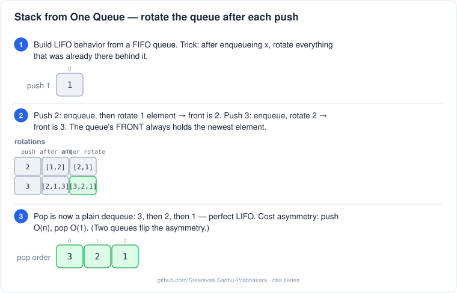

# Implement Stack Using a Single Queue

> Striver SDE Sheet 077 · Day 13 Stack & Queue — push, then rotate the queue so the newcomer reaches the front: O(n) push buys O(1) pop. Go, stdlib only, tested.

## Problem

Build a LIFO stack using only queue operations (enqueue at back, dequeue from front) — and only *one* queue, the harder variant of the classic.

## Approach

After enqueuing a new element behind n old ones, dequeue those n and re-enqueue them — the queue now reads newest-first, so Pop and Top are plain dequeue/front. The queue permanently holds the stack's elements in reverse insertion order; each push restores that invariant in O(n), making Pop/Top O(1). The alternative distribution (cheap push, O(n) pop with two queues) costs the same total work — which operation to make expensive is a real design choice this exercise makes you articulate. The queue here is a slice used strictly through queue moves: append at back, remove at front.

**Complexity:** Push O(n), Pop/Top O(1), O(n) space.

## Visual walkthrough

Read the picture top to bottom — each numbered frame is one moment of the algorithm
running on this repo's test example.

## Run

    go test ./...   # verify
    go run .        # demo

---

One of 191 repos solving Striver's SDE Sheet in Go — stdlib only, one problem per repo, every solution tested. Browse the set: [`dsa-*` repos](https://github.com/Sreenivas-Sadhu-Prabhakara?tab=repositories&q=dsa-&type=source).
